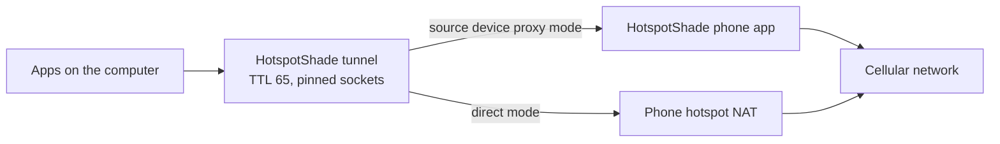

# HotspotShade

HotspotShade lets a computer use a phone's Personal Hotspot so that its
traffic looks like the phone's own traffic at the IP layer. It runs on the
computer that needs internet (the **target device**). It sends every flow out
again with a TTL of 65 and pins each outgoing socket to the hotspot interface.
The phone (the **source device**) NATs the packet and lowers the TTL by one, so
the carrier sees 64, the value the phone itself uses.

There is no VPN protocol, no relay server, and no cloud hop. Everything stays
between your computer and your phone.

> **Status: prototype.** HotspotShade is a research and testing tool, not a
> general-purpose VPN. It is not fail-closed: more-specific routes, local DNS,
> and network extensions can bypass the tunnel. Read
> [Limits](#security-and-limits) before you rely on it.

## How it works



There are two modes:

- **Direct mode** needs no app on the phone. The computer re-originates each
  IPv4 flow with TTL 65 over the hotspot link.
- **Source device proxy mode** adds a small phone app. The computer pairs with
  it using a six-digit code and sends its traffic through the phone's own
  cellular connection. This helps on carriers that treat hotspot traffic
  differently from the phone's own traffic.

## What works today

| Platform | Role | Status |
|---|---|---|
| macOS 14+ (Apple silicon) | Target | **Supported.** Verified on a live hotspot. Menu bar app plus command line. |
| iOS 17+ | Source | **Supported.** CI builds an unsigned IPA that you sign yourself. |
| Android 8.0+ | Source | **Works in emulator tests.** Pairing, source proxy, ICMP echo, and IPv6 are implemented. Not yet tested on a real phone, carrier, or hotspot. |
| Linux | Target | **Works in VM tests.** Direct mode and source device proxy mode pass in a disposable VM. Electron app with tray, notifications, and a packaged `.deb`. Not yet tested on a live hotspot. |
| Windows 10/11 | Target | **Implemented, live tunnel not yet verified.** Source device proxy mode via Wintun. Hermetic and native unit tests pass. The WinUI app is still a simulated preview. |

The [multiplatform roadmap](docs/MULTIPLATFORM_ROADMAP.md) lists what is left
before a release and how each platform will be tested.

## Get started

### Build the command line tool

You need a recent stable Rust toolchain.

```sh
cargo build --release --locked --manifest-path rust/Cargo.toml
```

The binary is `rust/target/release/hotspotshade`.

### Try it without changing anything

```sh
# Check the hotspot interface, DNS servers, and socket TTL. Changes nothing.
rust/target/release/hotspotshade probe

# Open the local page with simulated data. No root and no real traffic.
rust/target/release/hotspotshade gui --demo --no-open --port 8794
```

### Direct mode

Connect the computer to the phone's hotspot, then pick one:

```sh
hotspotshade socks5 --port 1080     # local SOCKS5 proxy, no root
sudo hotspotshade tun               # capture all traffic, needs root
hotspotshade gui                    # local control page on http://127.0.0.1:8787/
```

For SOCKS5, use `socks5h` so the proxy resolves names. Local resolution leaks
DNS:

```sh
curl --proxy socks5h://127.0.0.1:1080 https://example.com/
```

Stop `tun` with Ctrl-C or SIGTERM so it can remove its routes. Do not use
`kill -9`. If the hotspot is not your default route, add `--iface <name>`.

### Source device proxy mode

1. Turn on cellular data and Personal Hotspot, and connect the computer.
2. Open HotspotShade on the phone and tap **Start**. Keep the app open.
3. On the computer, open HotspotShade and choose **Pair with source device**.
4. Check that both screens show the same six-digit code, then allow it.
5. Choose **Turn on**. The computer asks for administrator rights.
6. Choose **Turn off** when you are done.

On the command line:

```sh
sudo hotspotshade tun --phone <hotspot-gateway>:<port>
```

The token comes from a hidden prompt, a private file descriptor, or the
`HOTSPOTSHADE_PHONE_TOKEN` variable, never from an argument. More in
[PHONE_PROXY.md](PHONE_PROXY.md).

### Install the apps

- **macOS app:** `scripts/build_mac_app.sh build/HotspotShade-unsigned.zip`
  (needs Xcode). Right-click the app and choose Open the first time. See
  [macos/README.md](macos/README.md).
- **iOS app:** download the unsigned IPA from CI, sign it with your own Apple
  ID, and trust the profile. See [ios/README.md](ios/README.md).
- **Android app:** see [android/README.md](android/README.md).
- **Linux app:** see [linux/README.md](linux/README.md).
- **Windows:** the tunnel needs Administrator rights and a `wintun.dll` that you
  download yourself (the repository does not include it). See
  [windows/README.md](windows/README.md).

## Safety features

- The tunnel turns itself off when the hotspot link is gone or the phone stops
  answering. It never restarts by itself.
- Routes, addresses, and devices that the program creates are removed on every
  exit path.
- Pairing uses a code you compare on both screens. The phone token never goes
  to a browser or a log.
- The local page and proxy listen on `127.0.0.1` only. The phone listens on
  the hotspot address only.

## Security and limits

- **Not fail-closed.** More-specific routes, local DNS, and network extensions
  can bypass the tunnel.
- **DNS.** Direct tunnel mode sends DNS over a normalized socket. SOCKS5 mode
  needs `socks5h`. DoH and DoT use their own paths.
- **IPv6.** Direct mode blocks IPv6 by default. Source device proxy mode
  forwards it through the phone.
- **Throttling.** If the carrier throttles the hotspot bearer or the account,
  every byte is throttled. TTL changes do not defeat deep packet inspection, TLS
  server names, TCP options, or traffic analysis.
- **Privacy.** HotspotShade does not hide destinations from the carrier or
  protect traffic from the local network.
- **Prototype limits.** No roaming, no reconnect, no multi-user support.

To report a security problem, see [SECURITY.md](SECURITY.md).

## Documentation

| Document | Content |
|---|---|
| [docs/TECHNICAL_REFERENCE.md](docs/TECHNICAL_REFERENCE.md) | Architecture, privileges, DNS and IPv6, threat model, troubleshooting |
| [PHONE_PROXY.md](PHONE_PROXY.md) | Source device proxy, pairing protocol, local API, diagnostics |
| [docs/MULTIPLATFORM_ROADMAP.md](docs/MULTIPLATFORM_ROADMAP.md) | Production roadmap, parity table, test matrix |
| [docs/LINUX_TEST_VM.md](docs/LINUX_TEST_VM.md) | How the Linux tunnel is tested in a disposable VM |
| [PORTABILITY.md](PORTABILITY.md) | Porting notes for Windows and Linux |
| [AGENTS.md](AGENTS.md) | Contributor guide: invariants, CI, tests, safety rules |

## Repository layout

| Folder | Content |
|---|---|
| `rust/` | Engine and command line tool |
| `macos/`, `windows/`, `linux/` | Target apps |
| `ios/`, `android/` | Source device apps |
| `gui_assets/` | Local control page (HTML, CSS, JavaScript) |
| `desktop/` | Shared desktop demo with simulated data |
| `assets/logo/` | Logo sources |
| `scripts/` | Build and test scripts |

## Contributing

Read [AGENTS.md](AGENTS.md) first. It explains the rules that keep the design
working. All automated tests are hermetic: they create no route and no tunnel
device. Run the main checks from the repository root:

```sh
cargo test --locked --manifest-path rust/Cargo.toml
cargo clippy --all-targets --locked --manifest-path rust/Cargo.toml -- -D warnings
cargo fmt --manifest-path rust/Cargo.toml --check
scripts/swift_tests.sh   # macOS with Xcode, when you touch ios/
```

## Terms of service

Getting around a carrier's tethering limits can break the carrier's terms of
service or your plan contract. It can lead to throttling, account restrictions,
or termination. You are responsible for following the rules of your plan.
