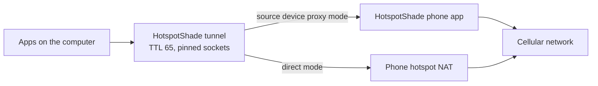

# HotspotShade

HotspotShade lets a computer use a phone's Personal Hotspot so that its
traffic looks like the phone's own traffic at the IP layer. It runs on the
computer that needs internet (the **target device**). It re-originates flows
that enter its tunnel with a TTL of 65 and pins their outgoing sockets to the
hotspot interface. If the phone (the **source device**) NAT lowers the TTL by
one, the carrier is expected to see 64, the value the phone itself uses.

There is no VPN protocol, no relay server, and no cloud hop. Everything stays
between your computer and your phone.

> **Status: prototype.** HotspotShade is a research and testing tool, not a
> general-purpose VPN. It is not fail-closed: more-specific routes, local DNS,
> and network extensions can bypass the tunnel. Read
> [Limits](#security-and-limits) before you rely on it.
>
> **macOS privilege boundary:** a tunnel start now uses a root-owned protected
> helper instead of elevating the bundled engine. The helper is not installed
> in an unsigned build, and an unsigned or ad-hoc app fails closed at Turn on
> with a plain unavailable message. The app has no demo mode; the Dashboard,
> pairing, status, and Settings use the real engine as your account. No
> Developer ID certificate is available in this repository. A locally signed
> release candidate passed one live iPhone test on 2026-11-06, including route
> cleanup after Turn off; that does not prove other networks or carriers.
> Do not describe an unsigned macOS build as protected.

## How it works



There are two modes:

- **Direct mode** needs no app on the phone. The computer re-originates each
  IPv4 flow with TTL 65 over the hotspot link.
- **Source device proxy mode** adds a small phone app. The computer pairs with
  it using a six-digit code and sends its traffic through the phone's own
  cellular connection. This helps on carriers that treat hotspot traffic
  differently from the phone's own traffic.

## What works today

| Platform | Role | Status |
|---|---|---|
| macOS 14+ (Apple silicon) | Target | **Prototype.** An earlier build was verified on a live hotspot. The current app's administrator-start security boundary needs work. |
| iOS 17+ | Source | **Prototype.** CI builds an unsigned IPA that you sign yourself. The signed release candidate is installed and launched on a physical iPhone, and the source proxy started on a real hotspot. Cross-platform live tunnel tests remain open. |
| Android 8.0+ | Source | **Prototype.** Emulator tests exercise pairing and proxy traffic with test network inputs. Production hotspot discovery and cellular binding need further work and device validation. Background status is implemented and JVM and loopback tested. Not yet tested on a real phone, carrier, or hotspot. |
| Linux | Target | **Desktop integration incomplete.** An earlier CLI snapshot passed isolated VM tunnel tests. The current uncommitted route cleanup changes need fresh review and VM evidence. The packaged Electron app has not yet been shown to start a real tunnel. Not yet tested on a live hotspot. |
| Windows 10/11 | Target | **Source device proxy mode and pairing implemented; never run on a Windows host.** Before each use of the source device token, the engine checks the routing table. The source device must be the default gateway of a physical Ethernet or Wi-Fi adapter, and that adapter must be the one the tunnel pins to. A VPN, a split default route, or a virtual adapter blocks the start with a fixed message. During a run, the first failed check turns the tunnel off. This check does not prove that the gateway is your source device. The v1 proxy sends a reusable token in cleartext over the hotspot link. Pairing, cancel, forget, and the pairing handoff to an elevated engine use the same API as macOS and Linux. Direct mode and SOCKS5 mode are not implemented. The command-line GUI requires an authenticated launcher with `--token-fd` and `--parent-fd`. The WinUI 2 app in `windows/` is that launcher: it starts the engine as the standard user for the dashboard, pairing, and status, and asks for one UAC prompt only at Turn on, when a packaged elevated starter starts the tunnel engine with the pairing handoff. It has no demo mode, has not been built or run on Windows yet, and is the app to test with `windows/BUILD_AND_TEST_ON_PC.md`. The console app in `windows/src/HotspotShade.WinUI2.TestLauncher` stays as a diagnostic fallback. |

The [multiplatform roadmap](docs/MULTIPLATFORM_ROADMAP.md) lists what is left
before a release and how each platform will be tested.

## Get started

### Build the command line tool

You need a recent stable Rust toolchain.

```sh
cargo build --release --locked --manifest-path rust/Cargo.toml
```

The binary is `rust/target/release/hotspotshade`.

### Try it without changing anything

```sh
# Print the engine package version without starting a service.
rust/target/release/hotspotshade --version

# Check the hotspot interface, DNS servers, and socket TTL. Changes nothing.
rust/target/release/hotspotshade probe

# Open the local page with simulated data. No root and no real traffic.
rust/target/release/hotspotshade gui --demo --no-open --port 8794
```

### Direct mode

On macOS or Linux, connect the computer to the phone's hotspot, then pick one.
Windows direct mode and the Windows SOCKS5 command are not implemented.

```sh
hotspotshade socks5 --port 1080     # local SOCKS5 proxy, no root
hotspotshade socks5 --dns-servers 1.1.1.1,8.8.8.8   # Linux needs this
sudo hotspotshade tun               # capture routed traffic, needs root
hotspotshade gui                    # local control page on http://127.0.0.1:8787/
sudo hotspotshade gui --token-fd N  # root needs a secret on descriptor N
```

For SOCKS5, use `socks5h` so the proxy resolves names. Local resolution leaks
DNS:

```sh
curl --proxy socks5h://127.0.0.1:1080 https://example.com/
```

On macOS, SOCKS5 discovery reads `scutil --dns` and accepts only an unambiguous
resolver for the selected interface. Linux resolver files are one aggregate
list and do not prove which link a server belongs to, so a Linux SOCKS5 start
fails closed unless `--dns-servers` names one or more numeric servers. The list
accepts at most 8 entries, with an optional port. Every query still goes
through a normalized socket pinned to the selected interface. A VPN, tunnel, or
loopback interface is refused, and a production start also refuses a loopback
DNS server because it is a local stub. A loopback interface with a loopback
resolver exists only as a test seam compiled into unit tests; the GUI and CLI
cannot select it.

Stop `tun` with Ctrl-C or SIGTERM so it can remove its routes. Do not use
`kill -9`. If the hotspot is not your default route, add `--iface <name>`.

### Source device proxy mode

The current proxy authentication and forwarded traffic have no encryption
provided by HotspotShade on the hotspot link. Applications may add their own
encryption. An impostor source device on that link can capture the token. Use a
hotspot you trust; pairing alone does not authenticate the later proxy
connection. The authenticated transport design is not implemented.

The unsigned macOS app can run its real engine as the signed-in user for the
dashboard, pairing, settings, and diagnostics. Starting a tunnel needs the signed
protected helper, which the local preview coordinator installs (see
macos/Helper/README.md). The Windows app is wired to the real engine through its
broker and elevated starter, and it has not been built or run on Windows yet.
The Linux app's real tunnel integration still needs live verification.

On macOS or Linux, the unprivileged command-line `phone` adapter can exercise
the source proxy for applications configured to use its local SOCKS listener:

```sh
hotspotshade phone --phone <hotspot-gateway>:<port>
```

It asks for the token at a hidden prompt and listens on `127.0.0.1:1081` by
default. Configure the application to use SOCKS with remote DNS, then stop the
adapter with Ctrl-C. This does not set a system-wide route or test the macOS
app's tunnel. A physical Android hotspot and current Mac build still need
validation; see [PHONE_PROXY.md](PHONE_PROXY.md) for details.

On the command line:

```sh
sudo hotspotshade tun --phone <hotspot-gateway>:<port>
```

For the command-line adapter and tunnel on macOS and Linux, the token comes from a hidden prompt, a private file
descriptor, or the `HOTSPOTSHADE_PHONE_TOKEN` variable, never from an
argument. Prefer the prompt or the descriptor. The command removes the
variable from its own environment right after it reads it, so child commands
do not inherit it. Windows supports the prompt or environment variable, but not the
private descriptor for this command. More in
[PHONE_PROXY.md](PHONE_PROXY.md).

### Install the apps

- **macOS app:** `scripts/build_mac_app.sh build/HotspotShade-unsigned.zip`
  (needs Xcode) builds an ad-hoc signed app. It runs the real engine as your
  account for the Dashboard, pairing, status, and Settings. Turn on needs the
  signed helper, and the helper installation is not approved. See
  [macos/README.md](macos/README.md).
- **iOS app:** download the unsigned IPA from CI, sign it with your own Apple
  ID, and trust the profile. See [ios/README.md](ios/README.md).
- **Android app:** see [android/README.md](android/README.md).
- **Linux app:** see [linux/README.md](linux/README.md).
- **Windows:** the source device proxy tunnel needs Administrator rights and a
  `wintun.dll` that you download yourself (the repository does not include
  it). Pairing works without Administrator rights. The real command-line GUI
  is reserved for an authenticated launcher that passes `--token-fd` and
  `--parent-fd`. See [windows/README.md](windows/README.md).

## Safety features

- The tunnel can stop when the observed hotspot link is down or the source
  device stops answering. Windows currently has no hotspot link observer.
  The Windows CLI and command-line GUI stop after sustained source device
  silence, and they stop at once when the source device is no longer the
  proven default gateway of the physical adapter. In the GUI, missing or stale probe results reset the timer, so loss of
  usable probe evidence can leave the tunnel running. This behavior has not been
  verified on a Windows host. A link check cannot prove that an interface is
  still connected to the intended hotspot.
  The tunnel never restarts by itself.
- Normal stop and handled failures attempt to remove owned routes, addresses,
  and devices. A crash can leave Linux policy rules behind. The next start
  may recover recorded objects from a private route claim when its checks pass.
  The claim is not kernel proof of ownership. The recovery changes are still
  under review, and a cleanup failure requires inspection before starting again.
- Pairing uses a code you compare on both screens. The service does not return
  the phone token to the browser or write it to a log. Manual token entry is a
  fallback that sends the value typed in the browser to the service.
- On iOS, token rotation is disabled pending a reviewed recovery protocol. Forgetting a paired target does not revoke a token it already holds, and this build has no reviewed token-revocation path. The trust list is stored in UserDefaults; a power loss before a forget is durable can leave that target trusted. Staged rotation code has fake-backed tests, but Keychain and UserDefaults crash behavior, external writers, restore, and downgrade are not proven. Repair of an invalid item also remains unavailable. See [iOS token storage](ios/README.md).
- The local page and proxy listen on `127.0.0.1` only. The phone listens on
  the hotspot address only.

## Security and limits

- **Not fail-closed.** More-specific routes, local DNS, and network extensions
  can bypass the tunnel.
- **DNS.** Direct tunnel mode sends intercepted DNS over a normalized socket.
  SOCKS5 mode needs `socks5h`. On macOS the resolver selection requires an
  unambiguous `scutil` block for the selected interface; a full VPN resolver
  without an interface, a split-DNS resolver, and a local stub are rejected.
  That path has not been tested with a live VPN or hotspot. On Linux the system
  resolver files are one aggregate list, so the start fails closed and
  `--dns-servers` must name the resolver. Queries remain pinned to the selected
  interface, but an explicit server can still be the wrong one for that link;
  the person who names it accepts that choice. An OS, VPN client, or resolver
  that binds its own socket to the physical interface can bypass the tunnel.
  DoH and DoT use their own paths.
- **IPv6.** Direct mode blocks IPv6 by default. Source device proxy mode
  forwards it through the phone.
- **Throttling.** If the carrier throttles the hotspot bearer or the account,
  every byte is throttled. TTL changes do not defeat deep packet inspection, TLS
  server names, TCP options, or traffic analysis.
- **Source proxy security.** The proxy token and traffic cross the hotspot link
  without transport encryption. A device on that link that can impersonate the
  source device can capture the token or traffic. Pairing does not authenticate
  the subsequent proxy connection. Use only a trusted hotspot network.
- **Privacy.** HotspotShade changes the outer IP TTL only. It does not hide
  destinations from the carrier or protect traffic from the local network. See
  [Destination privacy](#destination-privacy).
- **Prototype limits.** No roaming, no reconnect, no multi-user support.

### Destination privacy

Destination-name privacy is separate from tethering detection. No destination
privacy control is implemented today, and every proposed control is opt-in.

- **Destinations stay visible today.** The source device proxy is a byte relay.
  It forwards the target application's TLS bytes without parsing them. The
  carrier can still see destination IP addresses and traffic patterns, and
  may see TLS server names and DNS queries. Applications can independently use
  ECH or encrypted DNS; TTL normalization and the current relay do not add
  those protections.
- **`shape` (TLS record re-framing) is aspirational and unavailable.** When
  built, it would only change how the first TLS records are cut into segments.
  It would not hide the server name, destination address, DNS, or traffic
  pattern. It cannot pad without corrupting the handshake.
- **Application-wide `hide` is unsupported.** The engine relays an
  application's TLS bytes and cannot add Encrypted Client Hello to that
  handshake. An ECH-enabled connection originated by the engine would protect
  only that connection, not other applications' TLS traffic. The encrypted DNS
  design is a separate, unapproved proposal. Do not claim ECH or encrypted DNS
  coverage before it is implemented and measured.
- **`cover` (a TLS tunnel to an endpoint that you own) is deferred.** It needs
  your own endpoint. This project has no third-party relay, VPS, or cloud hop
  and does not add one.
- **Phone-side TLS termination is out of scope.** It would need a CA that the
  target device trusts and would break certificate pinning.
- **Foreground limit on iOS.** The app has a background keep-awake option, but
  iOS can suspend it. Sustained background relay is not guaranteed.
- **Billing and detection.** Destination-name privacy is not a billing change.
  No mode is shown to change how a plan is billed, throttled, or metered, and
  none is shown to defeat carrier detection that combines TCP/OS
  fingerprints, DNS behavior, volume, and timing. A carrier can still enforce
  its terms at the account or bearer level.
- **Your responsibility.** Read your carrier's terms and follow local law. You
  are responsible for how your plan may be used.

The proposal and its open questions are in
[docs/SNI_HIDING_PLAN.md](docs/SNI_HIDING_PLAN.md). It is a plan, not an
implemented feature.

To report a security problem, see [SECURITY.md](SECURITY.md).

## Documentation

| Document | Content |
|---|---|
| [docs/TECHNICAL_REFERENCE.md](docs/TECHNICAL_REFERENCE.md) | Architecture, privileges, DNS and IPv6, threat model, troubleshooting |
| [PHONE_PROXY.md](PHONE_PROXY.md) | Source device proxy, pairing protocol, local API, diagnostics |
| [docs/MULTIPLATFORM_ROADMAP.md](docs/MULTIPLATFORM_ROADMAP.md) | Production roadmap, parity table, test matrix |
| [docs/LINUX_TEST_VM.md](docs/LINUX_TEST_VM.md) | How the Linux tunnel is tested in a disposable VM |
| [PORTABILITY.md](PORTABILITY.md) | Porting notes for Windows and Linux |
| [AGENTS.md](AGENTS.md) | Contributor guide: invariants, CI, tests, safety rules |

## Repository layout

| Folder | Content |
|---|---|
| `rust/` | Engine and command line tool |
| `macos/`, `windows/`, `linux/` | Target apps |
| `ios/`, `android/` | Source device apps |
| `gui_assets/` | Local control page (HTML, CSS, JavaScript) |
| `desktop/` | Shared desktop demo with simulated data |
| `assets/logo/` | Logo sources |
| `scripts/` | Build and test scripts |

## Contributing

Read [AGENTS.md](AGENTS.md) first. It explains the rules that keep the design
working. All automated tests are hermetic: they create no route and no tunnel
device. Run the main checks from the repository root:

```sh
cargo test --locked --manifest-path rust/Cargo.toml
cargo clippy --all-targets --locked --manifest-path rust/Cargo.toml -- -D warnings
cargo fmt --manifest-path rust/Cargo.toml --check
scripts/swift_tests.sh   # macOS with Xcode, when you touch ios/
scripts/ios_source_proxy_flow_test.sh  # manual iOS proxy flow on loopback; needs port 18090 free
```

## Terms of service

Getting around a carrier's tethering limits can break the carrier's terms of
service or your plan contract. It can lead to throttling, account restrictions,
or termination. You are responsible for following the rules of your plan.
