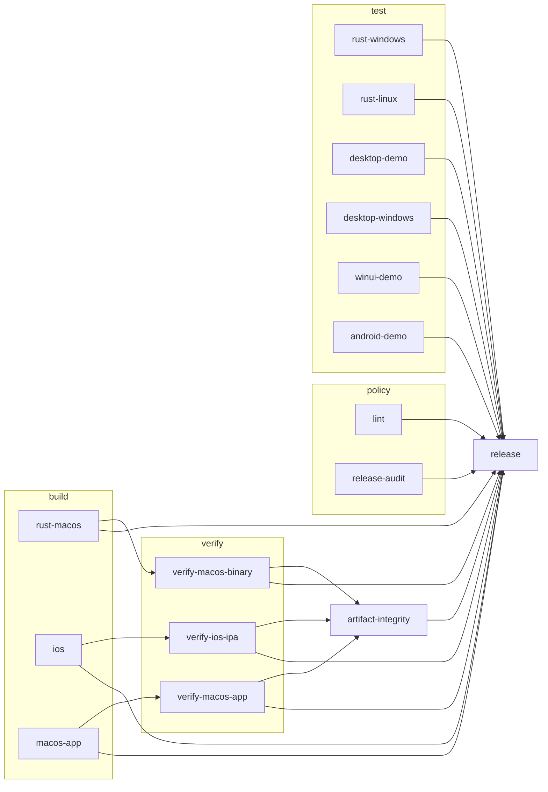

# CI pipeline and dependency graph

This page describes the jobs in `.github/workflows/ci.yml`, the `needs:` edges
between them, and what each job proves. The edges are real GitHub Actions
dependencies. GitHub draws them as a graph on the run summary page.

The workflow policy audit rejects the YAML spellings that could hide an
action reference, a permission grant, a repository secret, a retention limit,
or a shell override. The reviewed subset is block mappings and block
sequences, block scalars, single-line quoted scalars, a flow sequence used as
a value, and a one-line GitHub `${{ }}` expression. Explicit keys, a flow
collection in a node position, a flow mapping in a value, YAML tags, anchors,
aliases, merge keys, multi-line quoted scalars, tab indentation, a
workflow-level `defaults` mapping, an unsafe workflow-level `env` entry, a
duplicate top-level key, a duplicate job id, a YAML document marker or
directive, an expression that spans lines, an unknown top-level key, and any
byte outside printable ASCII, tab, and LF all fail closed. The byte rule
matters because YAML also reads NEL (U+0085), LS (U+2028), and PS (U+2029) as
line breaks. The audit and the graph check split lines on LF only, so text
after one of those separators on a comment line would be workflow structure to
GitHub and a comment to the scanner. Both scanners reject such a byte. Some
awk implementations end a record at a NUL byte, so both scripts also count
NUL bytes with `tr` before the line scan and fail on any. The subset is
strict on purpose: a one-line `run:` value that holds `${FOO}` or `{a,b}` reads
as a flow mapping and fails, and a job header with a trailing comment fails.
Use a block scalar for such a command.

The job checks read only one plain top-level `jobs:` mapping. A top-level
block scalar is valid YAML and can hold a line at the job-key indentation
that looks like a job header. The audit rejects a top-level block scalar, an
ambiguous top-level scalar continuation, a quoted or case-variant `jobs` key,
a second `jobs` mapping, and a duplicate job header (including one that
differs only by case). `scripts/release_audit.sh` also refuses a case-variant
spelling of any policy key, such as `Uses`, `Needs`, or `Permissions`, so the
result does not depend on whether GitHub reads workflow keys without case.
Every exact job block comparison, every `needs:` read, and the graph check
use that verified mapping. `scripts/tests/release_pipeline_test.sh` holds a
Psych-validated decoy for every reviewed job plus a fixture for each class.

A workflow-level `env` block may set only `CARGO_TERM_COLOR` and
`RUST_BACKTRACE`. Those names cannot change command lookup, shell startup, or
the loader in the release and verification steps. Add another name only with a
review that shows the same property. Inside any `env:` mapping, the command
environment names are compared without case. Windows reads environment names
that way, and `Path` and `PATHEXT` choose the command that runs there. The
blocked list therefore includes `Path`, `PATHEXT`, and `COMSPEC` spellings as
well as the exact names. A `path` input under `with:` is not an environment
variable and is not matched by this rule.

A job or step mapping may not repeat a key. GitHub can read the last value, so
a duplicate `steps`, `run`, `uses`, `with`, `needs`, or `if` key could hide a
command, an input, or an edge from a scanner that read the first value. The
audit rejects a duplicate key in a job mapping and in a step mapping. It also
rejects a plain scalar value that continues on a more indented line. YAML joins
the line and the shell can run the joined text, but the scan reads one line per
plain value. Use a block scalar for multi-line text. Content inside a block
scalar is still scalar content, not workflow structure.

Each scan in the audit must report at least one result line. A scan that prints
nothing fails closed instead of counting as a pass.

The audit and its fixtures still need another independent review and a CI run
before they can be relied on as a release gate. A graph-check pass proves the
checked dependency relationships, not that the workflow policy is sound.

## Version and project-file checks

The tag gate reads exactly one `version` key from the `[package]` table of
`rust/Cargo.toml`. It ignores `[package.metadata]` and every other table. It
accepts a basic double-quoted or literal single-quoted one-line TOML string,
and fails closed on a duplicate key, a workspace or inline-table value, a
multi-line string, or any spelling outside that subset. `cargo metadata` is not
a runtime dependency of the audit; the test suite uses it when cargo is present
to confirm the version that the fixture really describes.

The lockfile reader selects the root package entry, which has no `source` key.
A dependency with the same package name is not the root. A missing or
duplicated root entry fails closed. The desktop and Linux helper lockfiles use
the same rule.

The `Info.plist` reader removes XML comments, then requires exactly one
matching `<key>` followed by a `<string>`. A commented key, a duplicate key, or
a non-string value fails closed. The Xcode project reader removes `/* */` and
`//` comments outside quoted strings, accepts arbitrary whitespace and line
layout in the reviewed OpenStep subset, and requires exactly one
`MARKETING_VERSION` inside the `buildSettings` of each Debug and Release
configuration of the app target. A version at the configuration level is not a
build setting that Xcode applies, so it fails closed. A
`PRODUCT_BUNDLE_IDENTIFIER` outside `buildSettings` is ambiguous and also fails
closed. A comment or a quoted setting cannot supply a version. A duplicate key
or an unparsable construct fails closed.

The Gradle reader accepts one `versionName` string that is assigned directly in
`defaultConfig`. A suffix, a product flavor, a flavor dimension, a dotted
reference such as `defaultConfig.versionName`, a `versionName.set(...)` call,
and an `androidComponents` block all fail closed. Those spellings can replace
the value that the APK carries, and this reader does not evaluate them.

These readers are not full TOML, XML, or OpenStep parsers. They cover the
reviewed subset and reject everything else, so a valid but unusual spelling can
be refused. They do not evaluate Xcode build-setting inheritance or `$(VAR)`
expansion, and they do not prove that Xcode, Cargo, or the iOS toolchain uses
the value the reader found. The test suite validates its fixtures with an
independent parser when one is available, but that validates the fixtures, not
the audit's coverage of every possible file.

## Release artifact security

The release path binds the published bytes to the verification jobs with job
outputs, not only with artifact names:

1. Each verifier downloads one artifact, audits it, and records its SHA-256 in
   a job output from a step with a fixed id.
2. `artifact-integrity` receives those three outputs as `needs` values,
   recomputes each digest on the downloaded bytes, and refuses a mismatch. It
   then writes `SHA256SUMS`, verifies it, and records the manifest digest in
   its own job output.
3. `release` downloads `release-bundle`, checks all three artifact digests and
   the manifest digest again, runs the tagged audit, verifies the manifest,
   and only then publishes.

GitHub passes the output values from the named prerequisite job to the
dependent job. The release job does not trust a digest written into a file by
the upload step alone.

The scanner also enforces these rules:

- Every `uses` reference must match an exact reviewed owner, repository, and
  full commit SHA. A different SHA, a fork with the same repository name, or
  another action at a fixed SHA fails.
- A job-level `uses` key, which is a reusable workflow, fails. This workflow
  runs only reviewed step lists.
- An artifact name may be uploaded by one named job only. The approved pairs
  are `hotspotshade-macos-arm64` from `rust-macos`,
  `HotspotShade-iOS-unsigned-ipa` from `ios`,
  `HotspotShade-macos-unsigned` from `macos-app`, and `release-bundle` from
  `artifact-integrity`. Any other name, a second upload of the same name, or
  an `overwrite` key fails.
- An environment entry that can replace a command, compiler driver, loader, or
  shell startup file fails anywhere in the workflow. The list includes `PATH`,
  `BASH_ENV`, `LD_PRELOAD`, `DYLD_INSERT_LIBRARIES`, `RUSTC_WRAPPER`, `RUSTC`,
  `RUSTFLAGS`, `CC`, `CXX`, and `CARGO_HOME`.
- All 15 non-release jobs are exact matches against their corresponding
  `scripts/*_job.expected` blocks. The release job also has its own pinned block.
  The Rust Linux block builds `rust/target/debug/hotspotshade` and passes its
  absolute path as `HOTSPOTSHADE_BIN` to `npm test`, so the Node engine
  contract test cannot silently skip. The verifier, integrity, and release
  jobs keep their existing expected blocks.

The artifact audit also rejects a signing or key entry in the IPA and the
macOS app archive. The blocked names are `.key`, `.pem`, `.p8`, `.crt`,
`.cer`, `.p12`, `.pfx`, `.ppk`, `.mobileprovision`, and `.provisionprofile`,
without case. This is a name rule. It does not read file content, so a key
with another name or bytes embedded in a binary is outside it.

The audit validates the executable inside each app bundle, not only its size
and execute bit. The file must be a little-endian 64-bit arm64 Mach-O
`MH_EXECUTE`. Every load-command boundary and every segment file extent must
fit inside the file. The `LC_MAIN` entry point must lie after the header and
load commands, inside a nonempty executable segment. A header-only, stub,
truncated, wrong-architecture, or universal file fails. The IPA executable must
declare the iOS platform and the macOS app executable must declare the macOS
platform through `LC_BUILD_VERSION`, or through the older
`LC_VERSION_MIN_*` command when no build-version command is present. The audit
does not accept one platform for the other. The standalone engine binary is
checked the same way against the macOS platform. The load-command reader calls
`od -v`, so a repeated 16-byte row is not collapsed and cannot fail a valid
file.

The app `Info.plist` must be a nonempty plist. An XML plist is parsed by the
dependency-free reader. A binary plist is checked for its magic and, when
`plutil` is present, linted and read. The two app versions are compared with
the engine version in the artifact audit. Version drift warns in a plain run
and fails with `--require-aligned-versions`.

The release job runs the strict form. Under that option, an absent source
version file, an unreadable artifact version, and the standalone binary whose
version this audit cannot read from its bytes are release blockers. A binary
plist on a host without `plutil` cannot be read portably, so the strict release
fails closed with a line that names the artifact. The release gate therefore
stays closed until a reviewed artifact version reader covers the real binary
plists and the standalone binary has a verifiable version. A plain artifact
audit still prints the warning and exits zero, so the
platform verifier jobs keep reporting shape and digest evidence.

The strict version option does not turn an unsigned app warning into a failure.
The workflow separately requires `verify-macos-app` to run `--check-codesign`
on the uploaded archive, and the integrity job binds those bytes to the release
set. An isolated strict audit is not a substitute for that verification job.

Every `Swatinem/rust-cache` step carries the guard
`if: github.ref_type != 'tag'` as the next key of the same step mapping, at
the step key indentation. With the guard, the step does not run on a tag
build, so a cache entry from a branch or pull request cannot supply compiled
output to a tag release build through that step, and the contract test still
exercises the binary built in that run. The scan rejects a cache step without
the guard, and a guard line at another indentation, including in jobs that
have no exact block. The guard must be the next line after the `uses:` key, so
a guard after a `with:` mapping also fails. A `uses:` or `if:` key nested in
`with:` or `env:` is an input, not a step key: the scan rejects a `uses:` key
outside the step mapping key column, and a lone `-` item starts a new step, so
a cache input cannot carry over to the next step. A setup action can also restore a dependency cache
through its own input, such as `cache: npm` on `actions/setup-node` or
`cache: gradle` on `actions/setup-java`. That restore has no tag guard, so the
scan rejects a `with:` key that starts with `cache`, and the
`package-manager-cache` key, on every step except the tag-guarded
`Swatinem/rust-cache` step. The order of the cache input among the step keys
does not matter, and the key is compared without case, because GitHub passes an input name to the
action without case. The rule also rejects a value that disables the cache,
such as `cache: false`; remove the key instead. The pinned `actions/setup-node` is v4, which restores no cache unless an input
asks for one.

Only the `release` job may name a deployment environment, and only as
`environment: release` at the job level. Another job that names it, or an
`environment:` mapping in any other job, fails. The release job block is also
an exact match, so its environment line cannot change without a review of
`scripts/release_job.expected`.

A condition can skip a test step or a whole job and leave the job green, so
the scan allows only two conditions: the cache tag guard above, and the
job-level `if: startsWith(github.ref, 'refs/tags/v')` of the `release` job,
which its exact block pins. Any other key named `if`, in any job and at any
indentation, fails.

A shell override can also replace every command of a step and leave it green.
The scan allows only `shell: bash` on a step and rejects a job-level
`defaults`, `container`, or `services` key. The exact job blocks detect a removed
test step unless the expected block is changed too. A reviewed diff remains
necessary when a workflow or its expected block changes.

The repository hygiene scan enumerates tracked files with `git ls-files -z`
and passes NUL-separated names through `xargs -0`. It therefore sees a secret
that was force-added from a build directory that the older `find` scan pruned,
and it cannot split a file name at a space. A signing or capture file name is
compared without case, so `Identity.Key` and `Key.PEM` are found on a
case-insensitive file system. The content marker check reads every tracked
byte, including a binary blob, and recognizes private key blocks and common
access token prefixes. It prints only the path, never the file content or the
matching token.

## Limits

These checks reduce the reachable bypasses. They do not prove that the
workflow is trustworthy. The repository audit is not a trust boundary. It
reads the same commit that it checks, so a change to both the workflow and the
audited expected files still passes. Branch protection, required reviews, tag
protection, and the `release` environment rules are external controls. This
page does not replace them, and a green audit does not grant release approval.

- The artifact service, not this repository, decides whether an artifact name
  is immutable. `actions/upload-artifact` v4 rejects a duplicate name by
  default, and the audit rejects `overwrite`. A future action version or a
  service change could alter that behavior. This workflow does not consume a
  provider-supplied artifact digest, so the job outputs are the repository's
  own binding, not a provider-signed attestation.
- A job output is set by a step in the exact reviewed block. An actor who can
  change both the workflow and the matching expected file can change the
  policy. Branch protection, required reviews, the `release` environment, and
  a reviewed commit remain part of the gate.
- The digest chain proves that the published files are the bytes each verifier
  audited. It does not prove that the build produced those bytes from the
  reviewed source. The build job is trusted after its exact block review, and
  the verifier checks artifact shape, not reproducible compilation.
- The audit reads the scripts in the working tree. A local untracked or
  modified script is not bound to a reviewed commit. CI starts from a clean
  checkout, so the tracked copy is what runs there. A local change is evidence
  only after it is committed and reviewed.
- In a git work tree the scan reads the index, not untracked files. A secret
  that was never added is outside this check. The clean CI checkout makes the
  index the right set for a release run. The content marker check reads every
  tracked byte, including a binary blob, but recognizes only the listed markers.
- The Windows and Android jobs in this workflow are build and test signals
  only. They do not prove a live tunnel or a signed release.
- The version readers cover the reviewed TOML, plist, OpenStep, and Gradle
  spellings. They do not prove that the file is valid for its tool, that Xcode
  inherits a version from another configuration, or that the tool uses the
  value found. An unsupported but valid spelling fails closed. The archive
  signing rule matches entry names only; it does not read content.
- The Mach-O reader checks header, load-command, segment, entry-point, and
  platform framing. It does not prove that the code runs, that a signature is
  valid, or that every load command is semantically valid. The Info.plist
  reader validates the reviewed XML subset. A binary plist is only fully read
  when `plutil` is present; otherwise the strict release fails closed.
- The engine reports its package version with `--version` from a 64-byte record
  in the macOS `__TEXT,__hsver` section. The Linux audit cannot execute the
  macOS artifact and does not yet parse that record, so the strict artifact
  audit still reports it as a release blocker. A record is metadata, not proof
  of source, signature, or runnability.
  The record has eight magic bytes `HSSHVER1`, one format byte equal to 1,
  one version-length byte, up to 32 ASCII version bytes, and zero padding to
  64 bytes. The producer accepts only three nonempty decimal components
  separated by dots. Leading zeroes are accepted. A prerelease or build
  suffix, non-ASCII character, or version longer than 32 bytes fails the
  build. A reader must verify the section and its bounds before reading it.
- The workflow and graph scans are text checks over a reviewed YAML subset. An
  unsupported construct fails closed, but no text scan proves that GitHub and
  the scanner read the same tree for every possible YAML spelling. The exact
  block comparison and required review remain the control.

`scripts/ci_graph_check.sh` reads the same file and fails when an edge is
missing, names no job, makes a cycle, or lets the release job publish without a
prerequisite. It reads a `needs:` block list at the key indentation and one
level deeper, because both are valid YAML and GitHub reads the same edges. It
rejects a list that mixes the two indentation levels and any other indentation.
It also rejects a duplicate key in a job mapping, a `needs:` flow sequence that
does not close on the same line, and a plain scalar that continues on a more
indented line. Those spellings can hide an edge or change the value that GitHub
reads. The job stage tags in the workflow are the only labels the check needs.

The release audit also compares the complete publish job with
`scripts/release_job.expected` and each verification and integrity job with
its own expected block. A change to any of those jobs must update the matching
file and receive review alongside the workflow. This check catches unexpected
changes; it does not protect against an unreviewed change to both files or
replace repository branch and environment protection.

## Stages

A stage names the evidence a job produces. It is not a speed tier.

| Stage | Meaning | Failure effect |
|---|---|---|
| `policy` | A static gate over the tree, the release metadata, or the workflow itself. | Blocks release. Does not block the platform jobs, so a formatting failure does not hide test results. |
| `build` | Produces a release artifact and runs that platform's own tests. | Blocks the matching verify job, then the integrity job, then release. Other platforms still run. |
| `test` | A hermetic test suite for one platform. Produces no release artifact. | Blocks release only. Other platforms still run and report. |
| `verify` | Audits the uploaded artifact from one build job, not the build directory. | Blocks the integrity job and release. |
| `integration` | Joins the verified artifacts, writes the checksum manifest and provenance record, audits the joined set. | Blocks release. |
| `release` | Publishes the GitHub Release for a `v*` tag. | Nothing depends on it. |

## Graph



The same graph as the check prints it:

```
level 0  no prerequisites, run in parallel
  [policy     ] lint
  [policy     ] release-audit
  [build      ] rust-macos
  [test       ] rust-windows
  [test       ] rust-linux
  [test       ] desktop-demo
  [test       ] desktop-windows
  [test       ] winui-demo
  [test       ] android-demo
  [build      ] ios
  [build      ] macos-app

level 1  runs after its needs
  [verify     ] verify-macos-binary    <- rust-macos
  [verify     ] verify-ios-ipa         <- ios
  [verify     ] verify-macos-app       <- macos-app

level 2  runs after its needs
  [integration] artifact-integrity     <- verify-macos-binary verify-ios-ipa verify-macos-app

level 3  runs after its needs
  [release    ] release                <- lint release-audit rust-macos rust-windows rust-linux desktop-demo desktop-windows winui-demo android-demo ios macos-app verify-macos-binary verify-ios-ipa verify-macos-app artifact-integrity
```

## Jobs

| Job id | Display name | Runner | Stage | Needs | Artifact | Proves |
|---|---|---|---|---|---|---|
| `lint` | Lint | macOS | policy | - | - | clippy with `-D warnings` and `cargo fmt --check`. |
| `release-audit` | Release audit and CI graph check | Ubuntu | policy | - | - | Scripts parse, release metadata and workflow policy pass, the graph is valid, and the audit and portable reader fixture tests pass. The readers are not integrated into the release gate. |
| `rust-macos` | Rust (macOS) type check, test, build | macOS | build | - | `hotspotshade-macos-arm64` | Engine and relay tests, the source snapshot fixture suite on macOS, release build, GUI smoke test. |
| `rust-windows` | Rust (Windows) type check and test | Windows | test | - | - | Windows code compiles for x86_64 and i686, and its hermetic tests pass. It does not prove a live Windows tunnel. |
| `rust-linux` | Rust (Linux) foundation checks | Ubuntu | test | - | - | Linux engine and privileged helper tests and Clippy, the source snapshot fixture suite on GNU Linux, VM cleanup test, real demo engine contract through the Linux Electron Node tests, sandboxed webview smoke test. It does not create a TUN device. |
| `desktop-demo` | Shared desktop demo checks | macOS | test | - | - | Demo bridge, page model, browser failure report, webview smoke test, lint, format. |
| `desktop-windows` | Shared desktop demo checks (Windows) | Windows | test | - | - | The shared demo builds and tests on Windows. |
| `winui-demo` | WinUI demo model and build checks | Windows | test | - | - | WinUI state model, hermetic service foundation checks, Release builds of the console test launcher and release probe, and an unsigned UWP compile check. It stages no payload and does not deploy or run the app or service. No live tunnel. |
| `android-demo` | Android demo tests and build | Ubuntu | test | - | - | Android JVM tests, lint, debug app and instrumented-test APK builds. No emulator, no networking. |
| `ios` | iOS tests, simulator build, unsigned IPA | macOS | build | - | `HotspotShade-iOS-unsigned-ipa` | Swift logic tests, simulator build, unsigned IPA. |
| `macos-app` | macOS app tests and unsigned app | macOS | build | - | `HotspotShade-macos-unsigned` | App and installer Swift tests, preview preparation fixtures, and the unsigned app bundle. The signed preview and live installation are not tested in CI. |
| `verify-macos-binary` | Verify macOS binary artifact | Ubuntu | verify | `rust-macos` | - | The uploaded binary is a Mach-O arm64 executable. |
| `verify-ios-ipa` | Verify iOS IPA artifact | Ubuntu | verify | `ios` | - | The uploaded IPA has a `Payload` directory and no `_CodeSignature`, provisioning profile, `SC_Info`, or certificate. |
| `verify-macos-app` | Verify macOS app artifact | macOS | verify | `macos-app` | - | The uploaded app archive holds no provisioning profile or identity key, passes `codesign --verify --deep --strict`, and carries an ad hoc signature. |
| `artifact-integrity` | Assemble and checksum the release set | Ubuntu | integration | the three verify jobs | `release-bundle` | The joined set passes the artifact audit, `SHA256SUMS` covers every file, and `PROVENANCE.txt` names the commit. |
| `release` | Publish release | Ubuntu | release | every job above | - | The release set passes the tag audit and the checksum check, then `gh release create --verify-tag` publishes it. |

The `release` job runs only for a `v*` tag. On a branch or pull request it is
skipped, so the artifact and integrity jobs still produce evidence without a
publish step.

The `rust-windows` job also installs the `i686-pc-windows-msvc` target and runs
the type check and Clippy against it, so the 32-bit Windows FFI layout
assertions are compiled in CI. The job still runs no 32-bit binary.

## WinUI compile check and the payload

CI compiles the app; the PC build stages and checks the payload. The UWP
project fails its build unless `windows/out/payload` holds the broker, the
elevated starter, and the engine, and `windows/tools/stage_payload.ps1` builds
that folder with cargo, `dotnet publish`, and NativeAOT. The `winui-demo` job
does not need those artifacts to prove that the app compiles, so its msbuild
step passes `/p:HotspotShadeSkipPayloadCheck=true`. The property defaults to
false in `HotspotShade.WinUI2.csproj`, so the PC build keeps the check. Do not
pass the property for a package that you install.

The console test launcher and the release probe are not in the solution. The
job builds both explicitly in Release with `-warnaserror` so a change in either
project cannot break the Windows build unnoticed. Neither build publishes an
artifact or runs on Windows hardware.

## Deliberate non-edges

These edges are absent on purpose:

- No platform job needs `lint` or `release-audit`. One formatting mistake must
  not cancel the Windows, Linux, Android, and iOS results.
- No platform job needs another platform job. A macOS failure must not hide an
  Android result.
- `artifact-integrity` does not need the test jobs. It proves the shape and the
  digest of the artifacts. The test jobs prove behavior. The release job needs
  both, so the run summary shows which class failed.

## What a failure blocks

| Failed job | Still runs | Blocked |
|---|---|---|
| `lint` | every platform job, `release-audit`, all build and verify jobs | `release` |
| `rust-windows` or any test job | every other job | `release` |
| `rust-macos` | every other platform job, `verify-ios-ipa`, `verify-macos-app` | `verify-macos-binary`, `artifact-integrity`, `release` |
| a `verify` job | the other two verify jobs | `artifact-integrity`, `release` |
| `artifact-integrity` | nothing further | `release` |
| `release` | nothing | nothing |

A blocked job appears as skipped in the run summary. It is never marked as
passing.

## Required checks

Branch protection on `main` must require every job that produces evidence for
a release. Use the display names, because GitHub reports those check names:

```
Lint
Release audit and CI graph check
Rust (macOS) type check, test, build
Rust (Windows) type check and test
Rust (Linux) foundation checks
Shared desktop demo checks
Shared desktop demo checks (Windows)
WinUI demo model and build checks
Android demo tests and build
iOS tests, simulator build, unsigned IPA
macOS app tests and unsigned app
Verify macOS binary artifact
Verify iOS IPA artifact
Verify macOS app artifact
Assemble and checksum the release set
```

`Publish release` is tag-only. Do not require it on `main`, because it is
skipped on every branch run.

The `release` job names the `release` environment. Configure that environment
in the repository settings with required reviewers and a tag rule before the
first release. Without those rules the environment exists but adds no gate.

`AGENTS.md` lists the same jobs in a shorter table. This page is the reference
for the workflow as it is now.

## Validate the graph

```
sh scripts/ci_graph_check.sh
```

The check fails when:

- a job has no `# ci-stage:` tag, or the tag is not one of the six stages;
- a `needs:` entry names no job;
- a job needs itself;
- the graph has a cycle;
- more than one job is tagged `release`, or the tagged job is not named
  `release`;
- the `release` job does not reach every job through `needs`;
- a job mapping repeats a key, a `needs:` flow sequence does not close on the
  same line, a `needs:` block list mixes the key indentation with one level
  deeper, or an entry uses another indentation, or a plain scalar continues on
  a more indented line.

`scripts/tests/release_pipeline_test.sh` proves those failures. It builds a
small consistent tree, then adds a cycle, an unknown edge, an untagged job, a
missing release prerequisite, `continue-on-error`, a repository secret, an
upload without a retention limit, and a leaked `.p12` file, and checks that the
audit or the graph check rejects each one. It also mutates `ci.yml` with valid
YAML spellings that hid a write, an unpinned action, a secret, a retention
limit, a shell override, or extra release steps in an earlier revision. New
fixtures cover an unreviewed action SHA, a forked action owner, a job-level
reusable workflow, an upload `overwrite`, a foreign `release-bundle` upload,
an unknown artifact name, a `RUSTC_WRAPPER` environment entry, a changed build
command, altered digest outputs, and a removed release digest check. A
temporary git index proves that a force-added build secret and a file name
with a space are found without printing the secret.

The semantic fixtures cover a `[package.metadata]` version, a same-name
lockfile dependency, an XML comment and a duplicate plist key, Xcode whitespace
and comment decoys, a configuration-level `MARKETING_VERSION` and
`PRODUCT_BUNDLE_IDENTIFIER`, a duplicate job key, a duplicate step key, a plain
scalar continuation, a case-variant `Path` or `PATHEXT` environment entry, a
multi-line `needs:` flow sequence, a same-indent `needs:` block list, a dotted
Gradle `versionName`, an `androidComponents` block, and `.key`, `.pem`, `.p8`,
and `.crt` entries in both archives. The artifact fixtures use a real Mach-O
arm64 executable with an `LC_BUILD_VERSION`, including one whose load commands
hold repeated 16-byte rows, and prove a platform swap, a stub entry point, a
truncated header, a wrong architecture, and an unreadable binary plist. A
fixture that claims to be valid YAML is parsed with Psych before the audit
runs. When the parser is available, the suite also checks a plist fixture with
REXML, a manifest fixture with `cargo metadata`, and an Xcode project fixture
with `plutil`. Absence prints a note and skips that evidence check. These
parsers validate the fixtures; they do not prove that the audit implements the
whole grammar. Some earlier spelling fixtures are not parsed this way, and the
NUL fixture is not valid YAML on purpose. A bypass fixture that is not valid
YAML cannot prove a bypass.

`scripts/tests/source_snapshot_test.sh` and
`scripts/tests/source_snapshot_adversarial_test.sh` run on both `rust-macos`
and `rust-linux`. The macOS job uses BSD tools. The Linux job uses the GNU
runner environment. These suites
builds temporary git work trees only; it sets no route, creates no tunnel
device, and uses no network. The release audit pins both job blocks, so a
removal of either step fails the policy check.

Validate the YAML itself with any YAML parser before you push. The graph check
reads the structure the workflow uses; a YAML parser catches quoting and
indentation mistakes that a text check does not. The graph check rejects a
merge key, anchor, alias, or tag inside the jobs mapping, the Unicode line
breaks, and NUL, but it is not a standalone policy gate. CI runs the release
audit first in the same job.

The audit runs under POSIX `sh` and POSIX `awk`. The `release-audit` job uses
Ubuntu `dash` and `mawk`; a macOS developer machine uses BSD `awk`. Run the
suite on both when you change the scanner. A disposable Linux container gives
the Linux pair without changing the host:

```
docker run --rm -v "$PWD":/src:ro -w /src debian:bookworm-slim sh -c \
  'apt-get update -qq && apt-get install -y -qq bash zip unzip ruby && \
   bash scripts/tests/release_pipeline_test.sh'
```

The container needs network access to install its tools. It reads the mounted
tree and writes only to its own temporary directory. The container installs
bash, zip, unzip, and Ruby. It does not install cargo or plutil, so the Cargo
metadata and Xcode project parser checks print a note and skip there. The audit
itself uses only POSIX `sh` and POSIX `awk`.

## Add or change a job

1. Give the job a `# ci-stage:` comment directly above the job id.
2. Add the job to the `needs:` list of `release` when it produces release
   evidence.
3. If the job is a build, policy, verify, integrity, or release job, update
   its expected block file and the exact action allowlist in
   `scripts/release_audit.sh`.
4. Add the display name to the required checks list in this page.
5. Keep every job and step key unique. Use a block scalar for a multi-line
   value and do not let a plain scalar continue on an indented line. Close a
   `needs:` flow list on the same line, or use a block list.
6. Run `sh scripts/ci_graph_check.sh` and `bash scripts/tests/release_pipeline_test.sh`.
7. Keep the job hermetic: no route, no TUN device, no source device, no
   credential.
